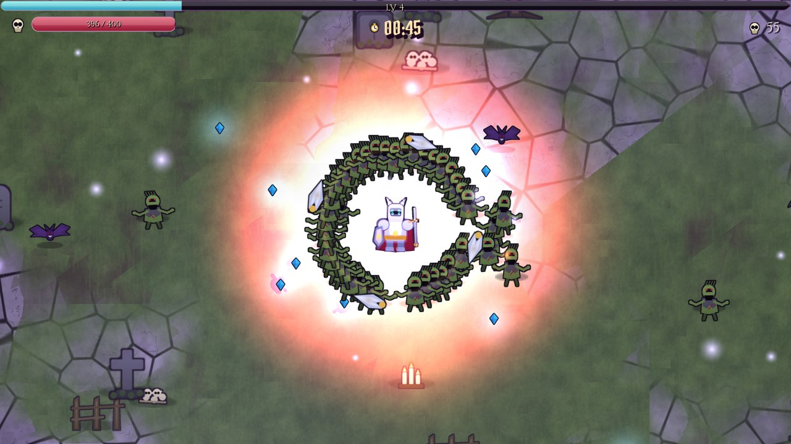

# Cursed Survivors

**A free gothic survivor-like for Windows: hold the arena against undead crowds,
evolve a cursed arsenal, and break the ring of elites that closes around you.**



[**Download for Windows**](../../releases/latest) ·
[**Play page / website**](https://dengarIicdk.github.io/cursed-survivors/) ·
[**Report a bug**](../../issues)

- **4 survivors** — Hexblade, Ironclad, Wraithborn, Stormcaller, each with their own weapon branch
- **10+ weapons and evolutions**, 9 enemy types with individually telegraphed attacks
- **The closing ring** — a wall of elite bodies that contracts every 90 seconds
- **2 biomes**, meta-progression through souls, a shop whose prices climb with every level
- **EN / RU** interface, full audio (procedural music and SFX), settings for volume, resolution and window mode
- **No external assets** — every sprite, tile, icon and sound is generated by the scripts in `tools/`

Engine: **Godot 4.7**. Licence: **MIT**. Fonts: SIL OFL.

---

## Run it

**Players:** grab `CursedSurvivors-1.0-win64.zip` from the releases page, unzip, run
`CursedSurvivors.exe`. No installer, saves live in
`%APPDATA%\Godotpp_userdata\CursedSurvivors\`.

**Developers:**

```bash
git clone <this repo>
# open project.godot with Godot 4.7, or:
godot --path . --editor
```

Regenerate all art and audio (Python 3, Pillow, NumPy):

```bash
cd tools
python gen_sprites.py ..    # sprites, props, tiles
python gen_ui.py ..         # panels, bars, buttons, fonts setup
python gen_depths.py ..     # second biome props
python gen_wildlife.py ..   # ambient critters
python gen_audio.py ..      # music loops and sound effects
```

Export a Windows build:

```bash
godot --headless --path . --export-release "Windows Desktop" build/CursedSurvivors.exe
```

The website in `docs/` is plain HTML/CSS and is published with GitHub Pages.

---

# Cursed Survivors — 2D Vampire Survivors-style Game in Godot 4

A top-down gothic dark fantasy auto-battler / bullet-heaven built for **Godot 4.3+ (GDScript 4.x)**.

## 🚀 How to Open and Run

1. Open **Godot Engine 4.3+**.
2. Click **Import**, navigate to `Z:\WIBECODING\VampireSurvivors` and select `project.godot`.
3. Press **F5** (or the Play button in the top right) to run the game!
4. The game starts at the Main Menu (`res://scenes/main/main.tscn` -> `res://scenes/ui/main_menu.tscn`).

---

## 🎮 Controls

| Action | Keyboard |
|---|---|
| Move Up | `W` or `Up Arrow` |
| Move Down | `S` or `Down Arrow` |
| Move Left | `A` or `Left Arrow` |
| Move Right | `D` or `Right Arrow` |
| Select Upgrade Cards | `1`, `2`, `3` or Mouse Click |
| Pause Game | `Escape` |

---

## 🧙 4 Playable Classes

| Class | Role | Starting Weapon | Unique Mechanic & Scaling |
|---|---|---|---|
| **Hexblade** | Dark Mage | Arcane Orbs | +15% spell damage per level. Kills have 10% chance to summon a spectral clone that attacks for 3s. |
| **Ironclad** | Warrior | Sword Splash | +20 Max HP per level, +10% passive armor. "Last Stand": When dropping below 25% HP, gains 2× speed & damage for 5s (60s cooldown). |
| **Wraithborn** | Rogue | Shadow Daggers | +10% Move Speed & +5% Crit chance per level. "Blink": Every 8s teleports behind the nearest enemy cluster and triggers an AoE burst. |
| **Stormcaller** | Shaman | Lightning Chain | +10% Attack Speed per level. "Surge": Every 50 kills unleashes a full-screen lightning storm damaging all enemies. |

---

## ⚔️ Weapons & Evolutions

Weapons upgrade through **5 levels** and evolve when paired with their signature passive item:

| Base Weapon | Signature Passive | Evolved Weapon | Evolution Effect |
|---|---|---|---|
| **Arcane Orbs** | Spellbook | `Chaos Vortex` | 6 giant orbs form a rapid rotating death vortex with 2× damage. |
| **Chaos Bolt** | Grimoire | `Void Requiem` | 5 homing bolts per cast, each detonating in a wide warp burst. |
| **Sword Splash** | Armor Shard | `Bloodreaver` | Full 360° cleaves that heal for 15% of damage dealt. |
| **Shield Bash** | Iron Heart | `Bulwark Eclipse` | 180px slam, 0.9s stagger, huge knockback, heals on hit. |
| **Fan of Knives** | Poison Flask | `Crimson Waltz` | 12 piercing knives per volley, heavy poison. |
| **Frost Nova** | Time Shard | `Absolute Zero` | 210px double frost ring freezing the crowd solid. |
| **Blade Aura** | Armor Shard | `Juggernaut Spin` | Doubled radius, 1.8× damage, shockwaves on critical hits. |
| **Shadow Daggers** | Poison Flask | `Soul Reaper` | 7 daggers, infinite pierce, 5 stacks of deadly poison. |
| **Lightning Chain** | Battery Cell | `Thunderstorm` | 10 jumps, persistent storm cloud above player striking lightning every second. |

---

## ✦ 10 Passive Items

- **Bloodstone**: +5% lifesteal on all damage dealt.
- **Iron Heart**: +50 Max HP and immediate heal.
- **Quicksilver Boots**: +20% movement speed.
- **Grimoire**: +15% damage bonus to all attacks.
- **Shadow Cloak**: +8% chance to dodge any hit completely.
- **Soul Lantern**: Doubles XP collection magnet radius.
- **Cursed Ring**: +50% damage bonus, but reduces Max HP by 20%.
- **Phoenix Feather**: One-time revive per run with 50% HP.
- **Time Shard**: -15% weapon cooldown reduction.
- **Leech Crown**: Lifesteal scales with kill count (scales up to 20%).

---

## 👾 8 Enemy Types & Bosses

1. **Shambling Corpse**: Basic undead swarmer with slight random jitter.
2. **Bat Swarm**: Fast erratic enemy weaving in a sine-wave pattern.
3. **Armored Knight**: Tough enemy with 30% armor reduction and a high-speed charge attack every 4 seconds.
4. **Ghost**: Ignores terrain, phases periodically becoming invulnerable.
5. **Exploding Imp**: Fast kamikaze demon that starts a countdown within 40px and explodes for 35 AoE damage.
6. **Necromancer**: Stays at range (200px) and summons Shambling Corpse minions.
7. **Giant Troll (Miniboss, 8:00+)**: 800 HP behemoth with ground slam shockwaves, rushing charges, and an enrage state at 50% HP.
8. **Shadow Drake**: Fast flying drake circling the player and executing dive-bomb strikes.
9. **Lich King (Final Boss, 15:00)**: 5000 HP, 3 escalating phases:
   - *Phase 1*: Minion summoning and 200px AoE pulses.
   - *Phase 2 (60% HP)*: Armored minions, telegraphing screen-wide attacks, +30% speed.
   - *Phase 3 (30% HP)*: Flashing enrage, summons flying drakes, creates 5 persistent 50 DPS death zones.

---

## 🏛️ Project Architecture

```
Z:\WIBECODING\VampireSurvivors/
├── project.godot               # Godot 4.3 configuration & input mappings
├── autoloads/
│   ├── event_bus.gd            # Decoupled signal bus (EventBus)
│   ├── game_manager.gd         # State machine, run timer, kill counts, leveling
│   ├── save_manager.gd         # JSON meta-progression persistence (SaveManager)
│   └── audio_manager.gd        # Pooled SFX and crossfading BGM (AudioManager)
├── scenes/
│   ├── main/                   # Entry point (main.tscn)
│   ├── world/                  # World container (world.tscn), Camera, XPGems
│   ├── player/                 # Base player & class scenes (hexblade, ironclad, etc.)
│   ├── weapons/                # Weapon scene instances (arcane_orbs.tscn, etc.)
│   ├── enemies/                # 9 enemy and boss scene instances
│   └── ui/                     # HUD, LevelUpScreen, PauseMenu, GameOver, CursedShop
└── scripts/
    ├── components/             # HealthComponent, WeaponManager, PassiveManager
    ├── classes/                # Hexblade, Ironclad, Wraithborn, Stormcaller
    ├── weapons/                # BaseWeapon and 4 weapon scripts
    ├── items/                  # BasePassiveItem, 10 passives, ItemDatabase
    └── enemies/                # BaseEnemy, 8 enemy scripts, EnemySpawner
```

---

## 💰 Meta-Progression ("The Cursed Shop")

- Runs reward **Soul Coins** calculated from: `(time_survived * 0.5) + (kills * 0.1)`.
- Persistent saves are stored in `user://save_data.json`.
- In the **Cursed Shop**, spend coins to:
  - Unlock new character classes (Ironclad, Wraithborn, Stormcaller).
  - Purchase permanent stat upgrades:
    - **+25 Max HP** (up to 8 times)
    - **+5% All Damage** (up to 10 times)
    - **+3% Movement Speed** (up to 10 times)

---

## Art pipeline (all free / self-generated)

No external asset packs are shipped: every sprite, icon, frame and background is
painted procedurally by Pillow scripts in `tools/`, so the project stays
licence-clean and easy to restyle.

```
cd tools
python gen_sprites.py ..      # heroes, enemies, props, pickups, weapon fx
python gen_ui.py ..           # item icons, 9-patch frames, bars, menu art
python patch_fx.py            # rewires weapon/class visuals to FXKit
```

Fonts in `assets/fonts/` come from Google Fonts (SIL Open Font License):
Pirata One, Cinzel, Almendra, Metamorphosis / Vampiro One.

Engine assets:
- `shaders/ground.gdshader` — procedural graveyard floor (warped voronoi cobbles, moss, blood, bones)
- `shaders/atmosphere.gdshader` — drifting fog, vignette, damage flash, low-HP pulse
- `scripts/fx/fx_kit.gd` — orbs, blades, lightning, sparks, death bursts, blood decals
- `scripts/ui/ui_kit.gd` + `assets/ui/theme_cursed.tres` — one visual language for all screens

---

## Audio

All audio is synthesised from scratch by `tools/gen_audio.py` (helpers in
`tools/audio_lib.py`) with numpy — no third-party samples, no licensing
questions, everything is original.

```
cd tools
python gen_audio.py ..      # 21 effects + 6 music loops (~10 s)
```

- `assets/audio/sfx/*.wav` — 44.1 kHz mono: hits, orb/lightning impacts, gem
  pickups, coin, heart, level up, weapon evolution, enemy/boss death, player
  death, blink, surge, last stand, boss roar, run start, UI click/hover/denied.
- `assets/audio/music/*.wav` — 22.05 kHz seamless loops: `menu`,
  `graveyard_calm`, `graveyard_intense`, `depths_calm`, `depths_intense`, `boss`.

`autoloads/audio_manager.gd` owns playback:

- 12-voice SFX pool with per-sound throttle (no machine-gun spam) and pitch
  jitter, so repeated hits never sound mechanical.
- Two music players with crossfades; tracks are looped at runtime, so the
  import settings can stay default.
- The manager subscribes to `EventBus` itself (`enemy_killed`, `boss_spawned`,
  `player_damaged`, `level_up`, `weapon_evolved`, …), which keeps gameplay
  scripts free of audio code.
- Music ducks while the game is paused (fades run with the tree paused).
- The world track escalates automatically: `*_calm` → `*_intense` once the
  crowd passes 20 enemies or the run reaches 4 minutes, and `boss` takes over
  for boss fights.

---

## Class arsenals & difficulty

Progression is now per-survivor: `scripts/items/item_database.gd` holds
`CLASS_WEAPONS`, so a level-up only ever offers the kit of the class you picked.

| Survivor | Arsenal |
|---|---|
| Hexblade | Arcane Orbs · Chaos Bolt · Shadow Daggers |
| Ironclad | Sword Splash · Shield Bash · Blade Aura |
| Wraithborn | Shadow Daggers · Fan of Knives · Blade Aura |
| Stormcaller | Lightning Chain · Frost Nova · Arcane Orbs |

Each class's signature weapon is weighted higher early, and its favourite
passives appear more often. Every weapon still evolves at level 5 plus one
specific trinket (e.g. Sword Splash + Bloodstone → `Bloodreaver`).

Difficulty curve:

- Ordinary enemies scale with run time: HP ×(1 + 0.42/min), damage
  ×(1 + 0.28/min), speed up to ×1.32. Bosses keep hand-authored stats.
- Spawn rate climbs from 0.8/s to 11/s, elite chance from 3% to 28%.
- Every 70s after the 75s mark a closing horde ring spawns around the player;
  mini-bosses start at 2:30 and repeat every 2 minutes; the final boss arrives
  at 10:00.
- Knockback is now a 0.3s impulse instead of a permanent shove, and spacing
  rings are tight (2-18px), so crowds actually reach and hit you.
- XP curve softened to `10 × 1.45^(level-1)`, player invulnerability 0.62s.

---

## Settings & localisation

`autoloads/settings.gd` persists audio mix, window mode, resolution and language
to `user://settings.cfg`; `autoloads/loc.gd` holds the Russian string table.

- **Audio**: `Master`, `Music` and `SFX` buses are created at boot; the sound
  pool plays on `SFX`, both music players on `Music`.
- **Display**: `Windowed` / `Fullscreen (borderless)` / `Exclusive fullscreen`
  plus 1280x720 through 3840x2160. The project uses `canvas_items` stretch, so
  the UI scales with the window instead of breaking.
- **Language**: English and Russian, switchable live. English source strings are
  the keys, so an untranslated line simply falls back to English:

```gdscript
UIKit.label(Loc.s("LEVEL UP"), 66)          # -> "НОВЫЙ УРОВЕНЬ"
Loc.f("LV {n}", {"n": 7})                    # -> "УР 7"
```

Screens: `scenes/ui/settings_menu.tscn` (opened from the title screen footer or
from the pause menu as an overlay). Adding a language means adding a dictionary
to `loc.gd` and one entry to `Loc.LANGS` / `Loc.LANG_LABELS`.

---

## Late balance & map identity

**Sustain is capped, damage is not.** `HealthComponent.LIFESTEAL_CAP = 0.06` and
`heal_from_lifesteal()` is the only lifesteal entry point, so no combination of
Bloodstone (2%), Leech Crown (max 6%) or weapon heals can out-heal a crowd.
Sword Splash pays its heal once per swing, capped at 1.5% of max HP. Enemy
contact damage now scales `x(1 + 0.5/minute)` and elites hit for `x1.45`.
Standing still kills you in roughly two minutes.

**Blade Aura is no longer "orbs with swords".** The ring of blades tickles
whatever stands next to you, but the damage comes from `boomerang_blade.gd`:
a blade detaches, spirals out to its maximum reach, then curves back and cuts
again on the way home. Upgrades add blades, reach and a second boomerang; the
evolution (Juggernaut Spin) throws three.

**Infernal Depths is a real second map.** `scenes/world/world.gd` carries a map
config with its own ground palette (fed into `shaders/ground.gdshader`), fog
colour, ambient tint, enemy theme and decor theme. `scenes/world/decor.gd` swaps
graveyard props for ice crystals, basalt stalagmites, magma vents and frozen
bones (`tools/gen_depths.py`), with cyan glow pools instead of candlelight.
It is unlocked in the Cursed Shop for 300 souls.

**Procedural animation.** `scripts/fx/idle_bob.gd` gives every sprite a walk
cycle without a single animated frame: bob + squash-and-stretch that speeds up
with movement, a waddle lean, and `flip_h` facing. Player and all nine enemies
use it; the animation is driven by the parent's `velocity`/`speed`, so any new
body gets it for free.

## Working with an AI agent

`docs/AI_AGENT_PROMPT.md` holds a ready-to-paste prompt, an example task and the
Godot-MCP wiring needed to make another model verify its own changes in the
engine instead of guessing.

---

## Contact damage, crowd physics and ambient life

**Contact damage: every body in reach bites.** Three separate bugs hid the
damage. Enemy damage used to fire on `Area2D.area_entered`, so a wretch that
touched the hero during his post-hit invincibility was swallowed for good.
Enemy hitboxes used the same circle as the body (radius 10), while body collision
kept bodies 24 px apart and the hero's hurt box only reached 14 px, so touching
bodies were mathematically out of reach. And a global 0.75 s invincibility window
meant twenty bodies still produced one hit per window.

Now the model is per-attacker: each enemy has its own `contact_cooldown` (1.1 s,
`try_contact_hit()`), hitboxes are the body radius + 8 so a body that touches you
is always inside your hurt box, and `player.gd` sweeps the overlap every 0.1 s,
summing every attacker that is off cooldown. One tick may take at most 22% of max
HP, so a wall of bodies is brutal without deleting you instantly. Measured: 3
bodies → 23 damage per tick; 40 bodies → 59 per tick and near death in 2.4 s;
walking for 27 s → 300 to 263 HP.

**Damage numbers, quietly.** Every enemy carries one floating number that lives
0.6 s. Hits that land while it is still fresh are added to it instead of spawning
a second label, so a bullet-hell build shows two or three digits on screen rather
than a wall of text. The text is 15 px, 88% opaque, drifts upward and fades on a
squared curve; measured peak on screen during a full ring fight: 10 labels.

**The closing ring** (`scripts/world/ring_event.gd`). The first ring arrives after
80 s, then every 85 s — and the HUD counts down to it under the clock
("RING 1:18" / "КОЛЬЦО 1:18"), brightening as the moment gets close. Forty-four
bodies of three-to-four times normal HP and +45% damage appear on a 520 px circle
around the hero and ride the circle inward over 12 s. They hold formation instead
of chasing (`is_ring_member` in `base_enemy.gd`), so the boundary is made of
bodies, not of paint: there is no drawn ring line at all, only a short ground
pulse at the moment the wall appears. Neighbour spacing goes from 74 px at the
start (a readable escape window) to 21 px at the end, where the wall is closed.
Killing every member ends it early; escaping dissolves the survivors and drops a
soul shower. If it closes to 26 px the formation breaks and the wall simply lands
on you — with per-body contact damage that is what kills a build that cannot
clear a gap: measured standing inside, the ring took the hero from 300 to dead in
under two seconds.

**The map-crossing teleport.** Two things could move the hero outside his own
control. The Wraithborn's auto-blink aimed at the *centroid of the closest
enemies*, which is the crowd itself, with no distance cap. It now steps **away**
from that centroid and is clamped to 260 px. Independently, `player.gd` clamps
every physics step (`MAX_STEP_PER_FRAME`), so a 150-body depenetration burst can
never launch the hero across the arena; a 420-frame stress test shows the largest
single-frame move is the 259 px blink and nothing else.

**Every enemy type has its own attack**, all telegraphed (sprite flash + ring) and
driven from `base_enemy.gd` (`_begin_attack` / `_release_attack` /
`_shoot` / `_aoe_damage`):

| Enemy | Attack |
| --- | --- |
| Shambling Corpse | grab-lunge, 1.6x damage on the way in |
| Bat Swarm | screech ring, small damage but 35% slow |
| Ghost | chill touch on contact plus a cold burst |
| Exploding Imp | shrinking red fuse ring, then blast |
| Necromancer | shadow bolt from range, keeps distance |
| Armored Knight | telegraphed charge with an impact shockwave |
| Shadow Drake | circling dive plus an ember spit |
| Giant Troll | slam shockwave and a thrown boulder |
| Lich King | bone volley in a three-shard fan, nova, death zones |

Hostile shots live in `scripts/enemies/enemy_projectile.gd` and resolve by
distance to the hero, so a layer mismatch can never make them harmless.

**Ambient wildlife.** `scenes/world/wildlife.gd` keeps ~16 critters around the
hero: crows that burst into flight when he comes close, rats that scurry and flee,
moths that gather in his aura, and lost souls that fade in and out of the fog.
Sprites come from `tools/gen_wildlife.py`, everything is cosmetic (no collision,
no damage) and sits on a low z-index so it never competes with combat.

**Ground shader polish.** Stone cells dropped from 76 to 42 world units, each cell
now has a lit bevel and per-stone speckle, and the paving mask edge is roughened
with a high-frequency term. The gradient map of the result is organic texture, not
the flat polygonal patches it produced before.
